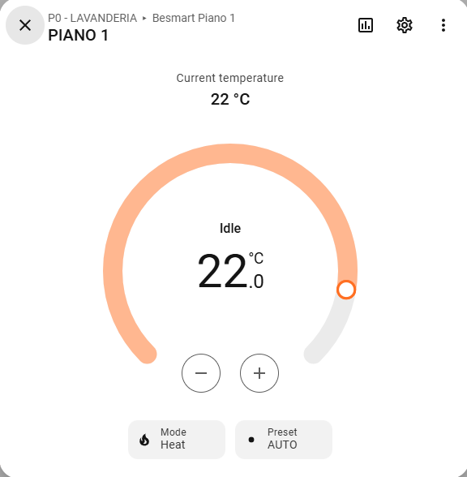
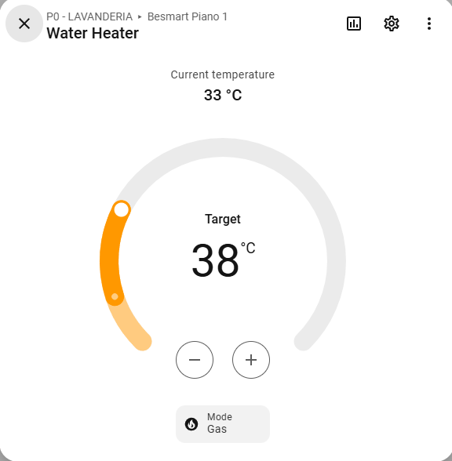
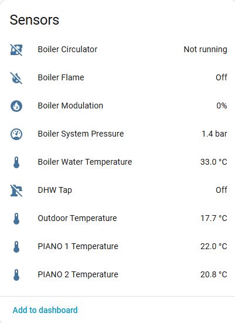
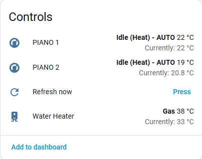
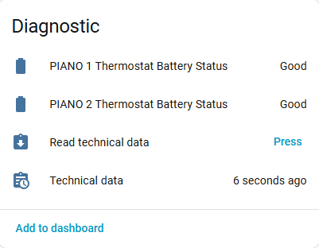

# BeSMART for Home Assistant

[](https://my.home-assistant.io/redirect/hacs_repository/?owner=candrea77&repository=ha-besmart&category=integration)
[](https://github.com/candrea77/ha-besmart/actions/workflows/combined.yaml)

Home Assistant integration for **Riello BeSMART** WiFi thermostats and the
boilers connected to them (Riello, Beretta and other brands of the group),
through the BeSMART cloud — the same service used by the official app.

## Features

- Control of every BeSMART thermostat: target temperature, translated
  presets (Auto, Manual, Away, Party, Frost protection), heating/cooling
  season.
- **Thermostat settings** (installer parameters): climatic curve, maximum
  and minimum flow temperature, room sensor influence.
- **Climatic curve chart** per thermostat (since 0.9.0): the curves of the
  Riello manual with the current settings, the outdoor temperature and the
  requested flow temperature.
- Domestic hot water (DHW): target temperature and boiler work mode.
- Boiler monitoring: pressure, flow (water) temperature, outdoor probe,
  **burner modulation (%)**, flame / circulator / DHW-tap states.
- On-demand **technical data** (flow/return/flue temperatures, DHW values,
  operating hours, ...) read only when you press a button.
- Config flow (UI setup), reauthentication, reconfigure, options,
  diagnostics, Repairs warnings, English and Italian translations.
- Security-minded: TLS verification on by default, secrets never logged,
  write commands validated before reaching the cloud (see
  [Privacy and security](#privacy-and-security)).

## Requirements

- **Minimum version:** Home Assistant **2026.7** (also declared in `hacs.json`).
- A BeSMART account working in the official app (WiFi box online).

Tested on:

- **Real installation:** Home Assistant **2026.10.1** with a Beretta Mynute
  X 30 C and 2 BeSMART thermostats.
- **CI (automated tests):** Home Assistant **2026.7** and the **latest stable
  release**.

## Installation

### HACS (recommended)

1. In HACS, search for **BeSMART** (by candrea77) and download it. The
   **Open in HACS** badge above is a shortcut to the same page.
2. Restart Home Assistant.
3. Go to **Settings → Devices & services → Add integration → BeSMART** and
   enter your BeSMART username and password.

If BeSMART does not show up yet (e.g. HACS has not refreshed its list), add
`https://github.com/candrea77/ha-besmart` as a *custom repository* of type
**Integration** (HACS → ⋮ → **Custom repositories**), then continue from
step 1.

> [!NOTE]
> This integration uses the domain `besmart_thermostat`, like
> [coder89/ha-besmart](https://github.com/coder89/ha-besmart): only one of the
> two can be installed at a time. Coming from coder89? See
> [Switching from coder89/ha-besmart](#switching-from-coder89ha-besmart).

### Manual

Copy `custom_components/besmart_thermostat` into the `custom_components`
folder of your Home Assistant configuration and restart.

### Switching from coder89/ha-besmart

Your existing BeSMART entry is migrated automatically: you do **not** need to
remove it or enter your credentials again.

1. **Make a Home Assistant backup** (the migration cannot be undone).
2. In HACS, open *BeSMART* from coder89 → ⋮ → **Remove** (this removes only
   the downloaded files, not your configuration). Do not delete the
   integration from *Settings → Devices & services*. If you had added
   coder89's repository as a custom repository, also remove that entry from
   HACS → ⋮ → **Custom repositories**.
3. In HACS, search for **BeSMART** (by candrea77), download it and
   **restart** Home Assistant.
4. On start, the entry is upgraded: credentials move to protected storage,
   TLS verification is turned on and the default update interval (300 s) is
   used. Check **Settings → Repairs** for any message.

What you keep and what changes:

- Thermostats (climate), water heater and the BeSMART device keep their
  entity IDs, history, dashboards and automations (the displayed name may now
  be prefixed with the device name).
- coder89's **Thermostat Battery** percentage sensors are replaced by
  **Thermostat Battery Status** (low / good). The old sensors become
  unavailable: update dashboards/automations that use them, then delete them
  from *Settings → Entities*.
- New entities (temperatures, pressure, modulation, flame/circulator/DHW
  binary sensors, buttons, technical data) are added.
- Username and password are no longer in the integration **Options**: use
  **Reconfigure** to change them.

To go back to coder89's version, restore the backup made in step 1.

## Configuration

| Setting | Where | Notes |
|---|---|---|
| Name, username, password | Setup | Credentials are verified before saving. Change them later with **Reconfigure**. |
| Work modes | Setup / Options | Heating and/or cooling. |
| Verify TLS certificate | Setup / Options | On by default. Turn off only if login fails because of a broken certificate chain (a Repairs warning is shown). |
| Update interval | Setup / Options | 180–600 s (default 300). |

## Entities

Devices (since 0.8.0):

- one **BeSMART WiFi box** device per account, with the boiler and DHW
  entities and the buttons;
- one device **per thermostat**, named after the room (e.g. *Living*) and
  linked to the WiFi box device, with the thermostat entities. Assign each
  one to its area in Home Assistant.

Entity names below are shown as *device name + entity name* (e.g. *Living
Thermostat*, *Casa Water Heater*).

**Thermostat device** (*&lt;Room&gt;*):

| Entity | Type | Notes |
|---|---|---|
| Thermostat | climate | One per thermostat. |
| Temperature | sensor | Temperature measured by the thermostat. |
| Thermostat Battery Status | sensor (diagnostic) | low / good / unknown. |
| Climatic Curve | select (configuration) | 0.2, 0.4, 0.6, 0.8, 1.0, 1.2, 1.5, 2.0, 2.5, 3.0. See [Thermostat settings](#thermostat-settings). |
| Max Flow Temperature | number (configuration) | 15–80 °C, step 1, never below the current minimum. |
| Min Flow Temperature | number (configuration) | 10–75 °C, step 1, never above the current maximum. |
| Room Sensor Influence | number (configuration) | 0–20, step 1. |
| Climatic curve chart | image (configuration) | SVG chart, read only. See [Climatic curve chart](#climatic-curve-chart). |

**WiFi box device**:

| Entity | Type | Notes |
|---|---|---|
| Water Heater | water_heater | DHW target 30–60 °C (whole degrees), work mode. |
| Boiler System Pressure | sensor | bar. |
| Boiler Water Temperature | sensor | Central heating flow temperature. |
| Outdoor Temperature | sensor | If an outdoor probe is installed. |
| **Boiler Modulation** | sensor | Burner modulation in %, polled with the other data. |
| Boiler Flame / Boiler Circulator / DHW Tap | binary_sensor | Boiler states reported by the cloud (see [Known limitations](#known-limitations)). |
| **Refresh now** (*Aggiorna ora*) | button | Immediate refresh of all polled data. Presses less than 10 s apart, or during a refresh, are ignored. |
| **Read technical data** (*Leggi dati tecnici*) | button (diagnostic) | Reads the boiler technical values once (never polled). 30 s cooldown. |
| Technical data (*Dati tecnici*) | sensor (diagnostic) | State = time of the last reading; attributes: `modulation_pct`, `pressure_bar`, `flow_temperature`, `return_temperature`, `flue_temperature`, `dhw_temperature`, `dhw_set_point`, `heating_set_point`, `dhw_flow_rate`, `flame`, `outdoor_temperature`, `high_condensation_hours` (operating hours in high-condensation mode), `heating_hours` (operating hours in heating), `dhw_hours` (operating hours in DHW), `temperature_unit`, `unsupported_endpoints`. Restored after a restart. |

Boiler entities and thermostat settings are created only when the WiFi box
reports a boiler.

### Thermostat presets and attributes

Since 0.10.0 the presets have lowercase values, translated in the UI. Use
the **value** in automations and scripts:

| BeSMART app | Value | English | Italian |
|---|---|---|---|
| Auto | `auto` | Auto | Automatico |
| Manuale - Comfort | `manual` | Manual | Manuale |
| Vacanza - Economy | `away` | Away (Home Assistant standard) | Fuori casa (Home Assistant standard) |
| Party - Comfort | `party` | Party | Party |
| Spento - Antigelo | `frost_protection` | Frost protection | Antigelo |
| Sanitario (DHW only) | no preset: the thermostat is *off* | | |

```yaml
action: climate.set_preset_mode
target:
  entity_id: climate.living_thermostat
data:
  preset_mode: away
```

To turn a thermostat off (BeSMART *Sanitario*, hot water only) use
`climate.turn_off` or `climate.set_hvac_mode` with `hvac_mode: off`;
`climate.turn_on` goes back to `auto`. Up to 0.9.x the presets were `AUTO`,
`MANUAL`, `ECO`, `PARTY`, `IDLE` (and a hidden `DHW`): see the 0.10.0
release notes.

Thermostat attributes:

| Attribute | Meaning |
|---|---|
| `mode` | BeSMART mode number: 0 auto, 1 manual, 2 away (holiday), 3 party, 4 frost protection, 5 off (DHW only). Stable across versions. |
| `ot_set_point` | OpenTherm set point reported by the cloud (raw value; 5 when the thermostat does not call for heat). Was `setpoint_OT`. |
| `comfort_temp`, `economy_temp`, `frost_temp` | Comfort, economy and frost protection temperatures. `comfort_temp` was `confort_temp`. |
| `battery_low` | Thermostat battery low. |
| `updating_temp` | A new target temperature has not reached the thermostat yet. |

### Thermostat settings

> ⚠️ **These are installer parameters.** They change the flow temperature
> the boiler produces for that thermostat (climatic curve, maximum and
> minimum flow temperature, influence of the room sensor). A wrong value can
> make rooms too cold or too hot, or exceed what the heating system (e.g.
> underfloor heating) can take. **Write down the current values before
> changing them**, and if unsure ask your installer.

They work like the settings page of the official app:

- they are shown only while the boiler is **online** (otherwise the entities
  are unavailable) and accept only the values the app allows;
- every change reads the current settings from the cloud first and sends
  them all back, changing only the selected one. Nothing is sent if the
  cloud returns partial data (try again a few minutes later); a command
  still being synchronised by the cloud does not block a new change;
- the minimum flow temperature can never be set above the maximum (or the
  maximum below the minimum): the limits of the two boxes follow the current
  values, and a change that would cross them is refused (change the other
  value first). After a refused value the box may keep showing it until the
  page is reloaded (Home Assistant frontend);
- the number boxes wait 1.5 s after the last change and then send a single
  write with the final value (several clicks on the arrows are one change).
  The box shows the chosen value at once; if the write fails it goes back
  to the value reported by the cloud;
- after sending, the value is read back. While the cloud is still passing
  the command to the boiler the new value can take a few minutes to show;
  if the cloud reports a different value an error is shown.

The values are read with the normal thermostat data: no extra requests.

### Climatic curve chart

> ℹ️ **The chart is indicative.** The curves were traced from the chart in
> the Riello manual: they are not the exact calculation done by the boiler.

One image per thermostat (*&lt;Room&gt; Climatic curve chart*, in Italian
*Grafico curva climatica*), in the configuration section of the thermostat
device. It only reads data already polled: no extra requests, nothing is
ever written.

- All the curves of the manual (0.2 … 3.0) in grey; the selected curve is
  highlighted and limited between the **minimum** (blue) and **maximum**
  (red) flow temperature, i.e. what the boiler can actually ask for. The
  part outside the limits is dashed.
- **Working point**: the selected curve at the outdoor probe temperature
  (*Outdoor Temperature* of the boiler).
- **Requested flow**: the flow temperature actually requested for that
  thermostat, shown at the same outdoor temperature, as read from the cloud
  (never recalculated), so you can see the effect of the room sensor
  influence. It comes from the thermostat while it calls for heat, or from
  the boiler target if the thermostat value is not usable; without a heat
  request there is no requested flow. The attribute
  `requested_flow_source` says which one was used.
- Manual formula, shown as a note: *T flow = T curve + (CLI × InFL × ΔT
  room)*. The chart does not assume whether the boiler applies the room
  influence before or after the min/max limits.
- No points without a valid outdoor temperature, or while the boiler is
  offline (*boiler unreachable*; curve and limits stay; since 0.10.0 with
  the same rule as the boiler entities, see
  [Boiler offline](#boiler-offline)). Thermostats or
  boilers not set to °C show *unsupported unit* and no curves.
- The flow axis goes from 20 °C to the max flow temperature + 15 °C (at
  least 50 °C, rounded up to the next 10; 100 °C without a max), and starts
  from 10 °C when the min or max flow temperature is below 20 °C. Curves
  leaving the chart at the top stop at the edge with their label.
- The legend shows the curve value at the outdoor temperature and, when the
  min or max flow temperature applies, the limited value (*curve 23.3 °C,
  limited to 24 °C*).
- **Off scale**: an outdoor temperature above 20 °C or below -16 °C, or a
  requested flow outside the flow axis, is held at the edge of the chart
  with a small triangle and the real value in the legend ("off scale"). The
  curve is never extrapolated beyond the manual: the value at the edge is
  used. Attributes `outdoor_off_scale` / `requested_off_scale`.
- The image is redrawn only when something visible changes: any change of
  curve, limits or influence, or the outdoor temperature / requested flow
  moving by at least 0.5 °C. The attributes always describe the image shown.
- Texts follow the Home Assistant language (English or Italian; other
  languages: English).
- **Light and dark colours follow the operating system / browser setting,
  not the Home Assistant theme.** The chart has its own neutral background,
  so it stays readable with either theme.

### Boiler offline

Since 0.10.0, when the BeSMART cloud reports that the boiler is not
connected to the WiFi box (`boiler.online` in the thermostat data, the same
information the official app uses), the boiler entities become
**unavailable** instead of showing the last values, which the cloud no
longer updates.

| Entity | Boiler offline |
|---|---|
| Boiler System Pressure, Boiler Water Temperature, Outdoor Temperature, Boiler Modulation | unavailable |
| Boiler Flame, Boiler Circulator, DHW Tap | unavailable |
| Water Heater | unavailable |
| Technical data, Read technical data, Refresh now | unchanged (the technical data is a stored reading with its time) |
| Thermostat, Temperature, Thermostat Battery Status | unchanged (the thermostat talks to the WiFi box, not to the boiler) |
| Climatic Curve, Max/Min Flow Temperature, Room Sensor Influence | unavailable, as before (immediately, like the official app) |
| Climatic curve chart | stays available, shows *boiler unreachable* without points |

- The boiler is considered offline only when the cloud keeps reporting it
  for **at least 4 minutes** (240 s, several consecutive updates), so a
  single offline reading changes nothing. Entities come back at the first
  update that reports the boiler online again. Nothing is remembered across
  a restart.
- If the cloud does not report the boiler state at all, nothing changes.
- While the Water Heater is unavailable, Home Assistant ignores commands
  sent to it (only a warning in the log, no error in automations). A
  command that arrives just as the boiler goes offline is refused with
  *The boiler is offline: domestic hot water cannot be changed.*
- No extra requests to the cloud.

### Supported languages

| Language | Setup, options, Repairs | Entity names, states, attributes |
|---|---|---|
| English | ✅ | ✅ |
| Italian | ✅ | ✅ (since 0.7.1) |

Entity names follow the Home Assistant language. Names are shown in the
table above in English; in Italian they become e.g. *&lt;Stanza&gt; Termostato*,
*&lt;Stanza&gt; Curva climatica*, *&lt;Stanza&gt; Mandata massima*,
*Acqua calda sanitaria*, *Modulazione caldaia*, *Fiamma caldaia* (Accesa /
Spenta), *Prelievo ACS* (In corso / Nessun prelievo). Thermostat presets
are translated since 0.10.0 (see
[Thermostat presets and attributes](#thermostat-presets-and-attributes)).

- **Entity ids never change on an update**: existing entities keep their
  `entity_id`, so automations and scripts keep working. Only the displayed
  name changes (if you renamed an entity, your name is kept).
- On a **new** installation, Home Assistant builds the entity ids from the
  names in its language: an Italian system gets e.g.
  `sensor.<device>_modulazione_caldaia` instead of
  `sensor.<device>_boiler_modulation`.

### Screenshots

Taken on a real installation (Beretta Mynute X 30 C, 2 BeSMART thermostats,
Home Assistant in English).

| | |
|---|---|
|  |  |
| **Thermostat** — current and target temperature, heat/cool mode and BeSMART preset. | **Water heater** — domestic hot water target (30–60 °C) and work mode. |
|  |  |
| **Sensors** — boiler states (circulator, flame, DHW tap), modulation, pressure, water and outdoor temperature, room temperatures. | **Controls** — one climate entity per thermostat, Refresh now button and water heater. |
|  | |
| **Diagnostic** — thermostat battery status, Read technical data button and Technical data sensor (time of the last reading). | |

## Tested devices

- **Beretta Mynute X 30 C** with 2 BeSMART WiFi thermostats
  (Home Assistant 2026.10.1).

Other BeSMART-compatible boilers should work; please report your model in an
issue (with a diagnostics file) so it can be added here.

## Known limitations

- **Cloud refresh:** the BeSMART cloud receives fresh data from the WiFi
  module only about **every 3 minutes**. Polling faster does not help, and
  **Refresh now** may return values that have not changed yet.
- **Flame state is not reliable:** the cloud's `flame_status` (Boiler Flame
  binary sensor) can stay *off* while the burner is running, e.g. during a
  DHW draw. Use **Boiler Modulation** (> 0 % means the burner is on) or the
  `flame` attribute of **Technical data** instead.
- **Partial thermostat data:** the cloud occasionally reports a thermostat's
  set points as 0 (or outside the limits of the official app). Those values
  are ignored and the last valid ones are kept; a season switch is not sent
  while the data is partial.
- Some technical values are not available on every boiler: they are listed
  in the `unsupported_endpoints` attribute.
- **Holiday end not available:** when a thermostat is set to *Vacanza -
  Economy* (`away`) the cloud does not report when the holiday ends, so
  Home Assistant cannot show it.
- Cloud only: no local control. If the BeSMART cloud is down, the
  integration cannot work.
- The login endpoint only accepts credentials in the URL (see below).

## Differences from the original project

This repository is a fork of
[coder89/ha-besmart](https://github.com/coder89/ha-besmart), itself derived
from [muchasuerte/ha-besmart](https://github.com/muchasuerte/ha-besmart).
Main changes:

- **Architecture:** single `DataUpdateCoordinator` (one round of cloud calls
  per cycle instead of one per entity), async HTTP with timeouts, no blocking
  calls in the event loop.
- **Setup and account:** config flow with login validation, reauthentication,
  reconfigure, options (update interval, TLS verification), one entry per
  account, diagnostics with redaction, Repairs warnings.
- **New entities:** boiler modulation, pressure, water and outdoor
  temperature, per-thermostat temperature, flame/circulator/DHW-tap binary
  sensors, Refresh now and Read technical data buttons, Technical data sensor.
- **Security:** TLS verification on by default, credentials and identifiers
  never written to logs or UI messages, validation of every command sent to
  the cloud, CI with pinned actions and automated tests.
- **Fixes:** season switching endpoint, timezone of the thermostat program,
  thermostat temperature rounding, many robustness fixes against malformed
  cloud data.

The full history is in the [release notes](https://github.com/candrea77/ha-besmart/releases).

## Privacy and security

**What is sent to the BeSMART cloud.** The integration talks only to the
Riello BeSMART cloud (`api.besmart-home.com`), like the official app:

- your BeSMART **username and password**, at login. The cloud's login
  endpoint only accepts them **in the URL query string** (POST is not
  supported), so they may end up in the access logs of Riello's servers: this
  is a residual risk we cannot remove. They always travel over HTTPS, with the
  server certificate verified by default;
- your **user id** and **WiFi box id**, in every request, together with the
  API token;
- the commands you send (temperatures, modes, thermostat settings).

**Treat `user_id` and `wifi_box_id` as secrets.** Never publish them.

**Where your credentials are stored.** In Home Assistant's config entry
storage (`.storage/core.config_entries`, like every integration). They are not
shown in the options form; change them with **Reconfigure** from the
integration menu. Removing the integration removes them.

**TLS.** Certificate verification is on by default (entries created by
versions before 0.7 are switched on automatically). If it is turned off, a
warning is shown in **Settings → Repairs**. Turn it off only if login fails
because of a broken certificate chain and you trust your network.

**What is redacted in logs.** Password, username/e-mail, the API token and
the user id are removed; WiFi box, thermostat and boiler ids are reduced to
their last 4 characters (`***1234`); the thermostat weekly program is
summarized; full request URLs are never logged, and error messages shown in
the UI never contain the original network error.

**Sharing logs and diagnostics safely.**

1. Prefer the diagnostics file: **Settings → Devices & services → BeSMART →
   ⋮ → Download diagnostics**. Credentials and identifiers are removed and
   WiFi boxes appear as `box_1`, `box_2`, ...
2. For logs, enable debug logging from the same menu, reproduce the issue,
   disable it to download the log, and **check it before posting**: search
   for your user id, WiFi box id and e-mail and replace them with `***`.
3. Never post screenshots of the BeSMART app's account or device pages.

## Troubleshooting

- Enable debug logging from **Settings → Devices & services → BeSMART → ⋮ →
  Enable debug logging**, or in `configuration.yaml`:

  ```yaml
  logger:
    logs:
      custom_components.besmart_thermostat: debug
  ```

- Open an [issue](https://github.com/candrea77/ha-besmart/issues) with the
  diagnostics file; read [Sharing logs and diagnostics safely](#privacy-and-security)
  first.

## Credits

- **Andrea Nicotra** ([muchasuerte/ha-besmart](https://github.com/muchasuerte/ha-besmart)) —
  original author of the integration (2020), whose MIT copyright notice is
  kept in [LICENSE](LICENSE).
- [coder89/ha-besmart](https://github.com/coder89/ha-besmart) — config flow,
  water heater and battery sensor, base of this fork.
- Everyone who reported issues and tested on their boilers.

This project is not affiliated with or endorsed by Riello S.p.A.

## Contributing

Contributions are welcome. Tests run with `pytest` (see
`requirements_test.txt`); development rules are in [CLAUDE.md](CLAUDE.md).

## License

[MIT](LICENSE)
